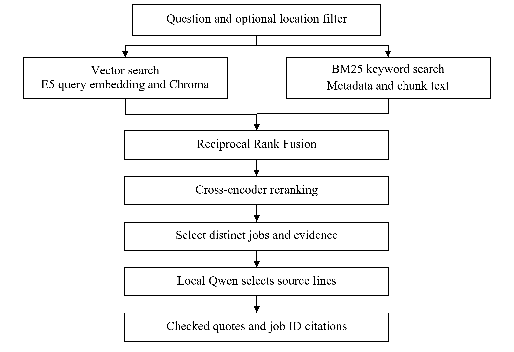

# Job Search RAG

Technical Report

GenAI Takeaway Assignment

Hybrid Search and Reranking with a Local LLM

Repository: https://github.com/nihal8866/job-search-rag

## Table of Contents

- [Introduction](#introduction)
- [1 Problem and data](#1-problem-and-data)
- [2 Data preparation and search](#2-data-preparation-and-search)
- [2.1 Technology decisions](#21-technology-decisions)
- [3 Local answers](#3-local-answers)
- [4 Setup and API](#4-setup-and-api)
- [4.1 Manager quick start](#41-manager-quick-start)
- [4.2 Installation from the repository](#42-installation-from-the-repository)
- [4.3 Recorded requests and responses](#43-recorded-requests-and-responses)
- [4.4 Worked question and answer](#44-worked-question-and-answer)
- [5 Evaluation](#5-evaluation)
- [6 Reproducibility](#6-reproducibility)
- [7 Limitations and further work](#7-limitations-and-further-work)
- [8 Assumptions and submission](#8-assumptions-and-submission)

## List of Figures

- Fig 1: Data Preparation Pipeline
- Fig 2: Question Answering Pipeline

## Introduction

This project searches the supplied job listings and returns relevant jobs with quoted source evidence. It includes the required RAG pipeline and FastAPI endpoint, plus hybrid search and a cross-encoder reranker. All models run locally without a paid model API. The system passed the development checks described below. A separate human review of search relevance has not yet been completed.

## 1. Problem and data

The goal is to search the supplied job listings and answer questions using their source evidence. The source workbook is data/raw/LF Jobs.xlsx. The table below summarizes the dataset and the resulting search index.

| Measure | Finding |
| --- | --- |
| Job listings | 1,000 across 145 companies and seven categories |
| Source fields | Nine columns in the supplied workbook |
| Missing metadata | Nine locations and 880 tag values |
| Duplicate records | Zero repeated IDs and zero fully duplicated rows |
| Cleaned descriptions | 1,000 nonempty descriptions |
| Search chunks | 3,618; 384-token windows with 48-token overlap |
| Embedding array | 3,618 vectors with 384 dimensions each |

Descriptions contain HTML and remain nonempty after cleaning. Publication dates parse as UTC and range from February 1, 2023 to August 1, 2025. These dates do not confirm whether a vacancy is still open. Eleven descriptions contain characters in the checked CJK range; this is a character check, not full language detection.

## 2. Data preparation and search

The following pipeline processes the job dataset and stores it in a reusable search index:


Fig 1: Data Preparation Pipeline

The query path combines semantic and keyword matches:



Fig 2: Question Answering Pipeline

BeautifulSoup removes HTML while the original description and date strings are
retained. Descriptions are split into 384-token windows with 48-token overlap.
This produces 3,618 chunks covering all jobs.

The embedding model is intfloat/multilingual-e5-small. Each input contains the
passage prefix, job title, company, category, level, and chunk text. Including long
location lists initially pushed 35 inputs over 512 tokens. Location is kept as
metadata instead; the final complete input has a maximum of 438 tokens.

GPU encoding produces normalized vectors with shape (3618, 384). Checks cover
finite values, unit norms, unique chunk IDs, job coverage, and saved-file alignment.
Reload checks compare both values and missing-value positions.

Chroma stores the vectors, source text, and metadata using cosine distance. BM25
indexes metadata and chunk text, including full locations. The shared keyword
tokenizer normalizes case, preserves C++/C#, and separates common CJK/kana characters.
It does not translate, stem words, or perform linguistic CJK word segmentation.

Vector and BM25 search each return up to 20 chunks. Equal-weight RRF combines
their rankings with k=60. BAAI/bge-reranker-v2-m3 then scores query/chunk pairs in
batches of four, after checking the 512-token pair limit. Results keep the best
candidate chunk per distinct job. This does not merge a job's full description.

An explicit location filter restricts both retrievers before their result limits.
It uses case-insensitive literal matching against recorded location strings.
It does not infer geography, aliases, or remote eligibility from the question.

### 2.1 Technology decisions

| Component | Choice | Reason |
| --- | --- | --- |
| Embeddings | Multilingual E5 small | Supports multilingual text and fits the available machine. |
| Vector storage | Chroma | Saves vectors and source metadata locally for reuse. |
| Keyword retrieval | BM25 | Adds exact-term matches, including programming languages and locations. |
| Rank fusion | RRF with k=60 | Combines the two rankings without mixing score scales. |
| Reranking | BGE reranker v2 m3 | Scores each question and candidate together before selecting distinct jobs. |
| Local answers | Qwen 3 4B through Ollama | Selects evidence locally without a paid model API. |
| Review interface | FastAPI | Provides a validated endpoint and an interactive question interface. |

Multilingual E5 supports the dataset’s English, Chinese, and Japanese text. Token-based chunking keeps descriptions within the model’s input limit. The 48-token overlap retains context around chunk boundaries, although it can repeat evidence and split sentences.

RRF combines rank positions rather than directly mixing vector and BM25 scores, which use different scales. Reranking adds a closer comparison between the question and each candidate, at a higher latency cost. The development evaluation does not establish a general quality gain from either enhancement.

Full locations remain in metadata and the BM25 corpus because long location
lists exceeded the embedding budget. Filtering both retrievers before their
candidate limits prevents an explicit location constraint from being applied
only after relevant local candidates have already been discarded.

## 3. Local answers

The answer model is qwen3:4b-instruct-2507-q4_K_M through local Ollama. Early
free-form answers overstated skills and produced incorrect inline citations.
Prompt-only revisions did not reliably fix those errors.

The current model selects up to three numbered source lines per job. A per-request
JSON schema limits the choices to that source. Application code checks the choices,
copies the text, and attaches the actual job ID. Empty selections produce an
insufficient-evidence answer; empty retrieval skips generation. Known metadata can
also be selected for company, location, level, and publication date.

This prevents model-written paraphrase and citation-typing errors in this adapter.
It does not guarantee relevant or complete evidence. Quotes can contain boilerplate,
repetition, or text cut at chunk boundaries. Historical data cannot establish
current application availability. See answer_design.md for the validation flow.

## 4. Setup and API

The tested machine uses Windows, Python 3.10.11, and an RTX 4060 Laptop GPU with
8 GB VRAM. Ingestion and notebooks use CUDA. The API uses CPU retrieval to leave
GPU memory for Ollama. It runs locally without a paid API or model API key.

The README contains installation and startup commands. job-rag ingest prepares
the data/index; search returns ranked evidence; ask adds the local answer step.
The original workbook is unchanged. If ingestion is interrupted, it must be rerun
because files and database updates are not one transaction.

### 4.1 Manager quick start

After completing the installation and ingestion steps below, use the following steps to review the running application.

1. Keep the local Ollama server running with the selected Qwen model installed.

2. In the activated project terminal, start the API with the command below.

python -m uvicorn job_rag.api:app --host 127.0.0.1 --port 8000 --workers 1

3. Wait for Application startup complete, then open http://127.0.0.1:8000/docs on the same computer.

4. Expand POST /api/query, click Try it out, enter the example JSON below, and click Execute.

5. Read answer and cited_job_ids under Response body. Expand jobs to compare each answer with its evidence and source_chunk_id.

6. Try an unknown location or ask for a salary absent from the evidence to check how the system handles missing information.

The local address works only on the computer running the API. A reviewer using another computer must install the project there or view a demonstration on the existing laptop.

POST /api/query accepts:

```json
{
  "query": "Python backend developer working with APIs and databases",
  "top_k": 2
}
```

top_k defaults to 2 and accepts 1-5. An optional location field applies the filter.
The response includes answer, cited_job_ids, jobs with source text/chunk IDs/scores,
and normalized request fields. Missing metadata becomes JSON null.

No eligible jobs returns HTTP 200 with empty results. Invalid input/model limits
return 422; busy or failed local inference returns 503; unexpected errors return
500 without internal details. One service loads at startup and processes one
inference at a time. GET /health checks retrieval readiness, not Ollama availability.
The listener is bound to 127.0.0.1 for local review. See api_usage.md for examples.

### 4.2 Installation from the repository

Install Python 3.10.11, Git, and Ollama first. The verified ingestion configuration
uses an NVIDIA GPU and a compatible driver; CPU-only ingestion and other platforms
have not been independently verified. Initial package and model downloads require
internet access and several GB of free storage. The project has no paid API or
hosting requirement; existing hardware, electricity, and connectivity are separate.

Run in PowerShell:

```powershell
git clone https://github.com/nihal8866/job-search-rag.git
cd job-search-rag
python -m venv .venv
.\.venv\Scripts\Activate.ps1
python -m pip --isolated install --index-url https://pypi.org/simple -r requirements-dev.txt
python -m pip --isolated install --no-build-isolation --no-deps -e .
python -m pip check
job-rag ingest
```

The first two lines download the repository and enter its folder. The next two
create and activate an isolated Python environment. The two install commands
install the recorded dependencies and make the local package available as
job-rag. pip check verifies dependency consistency. The final command cleans
the supplied workbook, generates embeddings, and builds the local index.
Generated indexes and embeddings are recreated locally and are not in Git.

Download the selected local answer model once:

```powershell
ollama pull qwen3:4b-instruct-2507-q4_K_M
```

Quit any already running Ollama tray app before starting a manually configured
server. In a separate PowerShell terminal, run:

```powershell
$env:OLLAMA_NO_CLOUD = "1"
ollama serve
```

The first line disables Ollama cloud features for this terminal's server process.
The second starts the local model server; leave that terminal running. Do not
start a second server if one is already serving on port 11434.

In the activated project terminal, start the API:

```powershell
python -m uvicorn job_rag.api:app --host 127.0.0.1 --port 8000 --workers 1
```

This loads the FastAPI application with one worker, listening only on this
computer. After startup completes, open http://127.0.0.1:8000/docs. Expand
POST /api/query, click Try it out, replace the example request, and click Execute.
Read the JSON under Response body. The root URL has no homepage and returns 404.
This local URL cannot be used by a reviewer on a different computer.

### 4.3 Recorded requests and responses

The following examples come from recorded API requests. The first response is a projection showing only selected fields; the complete responses, source chunks, metadata, and scores are retained in docs/api_examples.json and evaluation/api_results_2026-10-29.json. Model selections and timings can vary between runs; the examples are observations, not exact-output guarantees.

### 4.4 Worked question and answer

This recorded request shows how a question becomes a ranked answer with inspectable source evidence. The table follows the request through the main stages; the response and quoted lines below show the observed output.

| Stage | What happened in this example |
| --- | --- |
| Question and filter | The user asked for Python backend work with databases and supplied Singapore as the location. |
| Candidate retrieval | The location filter restricted both vector and BM25 retrieval before their candidate limits. |
| Ranking | RRF combined the candidate rankings. The reranker then ordered candidates, retaining the best chunk for each distinct job. |
| Returned evidence | LF0247 ranked first with chunk LF0247_chunk_001. LF0175 ranked second with chunk LF0175_chunk_001. |
| Answer construction | The local model selected source lines. Application checks copied those lines into the answer and attached the job IDs. |

Example request with a location filter:

```json
{
  "query": "Python backend developer working with databases",
  "location": "sInGaPoRe",
  "top_k": 2
}
```

Observed HTTP 200 response fields:

```json
{
  "query": "Python backend developer working with databases",
  "location_filter": "sInGaPoRe",
  "cited_job_ids": ["LF0247", "LF0175"]
}
```

The first result was Backend Software Engineer - Global E-commerce (Governance
Service), TikTok, Singapore, job LF0247. Its answer included these exact lines:

> - Candidate should have at least 5 years of experience in developing highly scalable backend services and systems using at least one of the following programming languages: Java, Golang, or Python.
> - In-depth knowledge of common databases and messaging frameworks such as MySQL, Redis, Kafka, and MQ is required.

The second result was Solutions Engineer, TikTok Ads, job LF0175. Its selected
evidence supported only part of the question. This distinction matters: the API
returns ranked evidence, not a guarantee that every result meets every condition.

Example request with an unknown location:

```json
{
  "query": "Python developer",
  "location": "NO_SUCH_LOCATION_000",
  "top_k": 2
}
```

Observed complete HTTP 200 response:

```json
{
  "query": "Python developer",
  "location_filter": "NO_SUCH_LOCATION_000",
  "answer": "No jobs were retrieved for the requested search and filters.",
  "cited_job_ids": [],
  "jobs": []
}
```

For a missing-fact check, the question "What is the exact annual salary for the
EPAM Senior Python Developer?" with location Brezno and top_k 1 returned HTTP 200
with LF0265 and the answer "An answer is not established by the selected evidence
for this job [LF0265]." Blank questions, blank locations, and top_k above 5 returned
HTTP 422 in the recorded validation cases.

## 5. Evaluation

The checks below separate software behavior from search relevance. Passing the technical checks does not establish that every recommended job satisfies every part of a question.

| Check | Recorded result | What it establishes |
| --- | --- | --- |
| Automated tests | 106 passed | Expected behavior for the tested code paths; model and database calls are mocked in unit tests. |
| Known target retrieval | Eight of eight targets in the top five for all three methods | Recovery of selected known jobs in eight development cases. |
| Fixed evidence answers | Five cases passed reference checks | Source selection and supported abstentions for the fixed inputs. |
| Live API | 12 cases; applicable contract checks passed | Observed HTTP behavior, filters, citations, and unsupported-fact handling. |
| Independent relevance review | Not yet completed | Broad relevance and accuracy remain unmeasured. |

Eight assistant-curated, source-derived queries test whether a known target job
is found. They cover six categories and include a Chinese query. These are
development cases, not independent labels or a held-out set. Other jobs remain
unjudged, so exhaustive recall, precision, and general accuracy are not claimed.

| Method | Target first | Target in top five | MRR@5 | Mean retrieval seconds |
| --- | ---: | ---: | ---: | ---: |
| Vector | 8/8 | 8/8 | 1.0000 | 0.122 |
| Hybrid | 8/8 | 8/8 | 1.0000 | 0.173 |
| Hybrid + reranker | 7/8 | 8/8 | 0.9375 | 6.476 |

The displaced target was behind another relevant meal-plan internship. This small
set does not show a general improvement from either optional enhancement. Timing
is one CUDA run excluding startup and generation, not a repeated benchmark.

Five fixed-evidence answer cases checked partial skills, missing salary/current
status, a known salary range, and recorded location. All passed reference checks.
Assistant source review found supported quotes and appropriate abstentions, but
also a less relevant selected line and no explicit list of missing API evidence.

Twelve live API cases covered mixed-case location filters, unknown locations,
invalid inputs, Chinese/Japanese targets, unsupported facts, one misleading user
instruction, and metadata. All applicable contract checks passed. Three known
targets ranked first; four unsupported-fact cases abstained. Review found repeated
Chinese source text and generic/fragmentary Japanese secondary evidence.

The eight inference requests averaged 17.65 seconds excluding startup. Different
workloads and one run per case preclude benchmark claims. Unit tests mock models
and database calls; real ingestion, generation, and HTTP checks are separate.
All 106 automated tests pass. Results, raw outputs, query provenance, and review
limits are retained in evaluation/ and described in evaluation.md/api_evaluation.md.

## 6. Reproducibility

All four notebooks ran successfully in separate, freshly started kernels. The development requirements and project package were also installed in a clean Python 3.10.11 virtual environment without access to system-wide packages. Running pip check found no dependency conflicts, and all 106 tests passed.

A separate source snapshot rebuilt 1,000 jobs, 3,618 chunks, normalized vectors,
and Chroma records. IDs, text, and embedding inputs matched working artifacts;
vectors matched within 1e-5. Import paths were checked. A fresh API query returned
the expected LF0265/LF0247 jobs with valid source quotes/citations in 37.86 seconds
after startup. The temporary server was stopped afterward.

The same Windows machine, driver, and existing package/model caches were used.
This does not test another platform, a clean user profile, or first-model downloads.
Ten indirect dependency versions differed from the earlier working snapshot; both
sets are retained. See setup_verification.md and the dated environment records.

## 7. Limitations and further work

Listings are historical. Location matching is literal, keyword segmentation is
basic, and token windows can split sentences. One-chunk job ranking can miss
requirements elsewhere in a description. Evidence selection can repeat passages,
include headings, or return only partial matches.

Next steps are independent relevance review, harder/no-answer queries, source-
prompt tests, multi-chunk evidence, and repeated latency/memory measurements.
Current checks do not establish production throughput or broad adversarial robustness.

## 8. Assumptions and submission

The supplied workbook is the source of job information. The implementation follows the assignment’s job-search RAG requirements and includes both optional enhancements: hybrid search and a reranker model.

The source workbook is the supplied assignment input and is kept in the repository.
Missing metadata is not invented. Scores are ranking signals rather than match
probabilities. Publication dates describe historical records rather than live
vacancy status. The local interface is intended for one reviewer at a time.

The repository contains code, notebooks, tests, the source workbook, dependency
records, and this report. The accompanying Word document is prepared for import
into Google Docs. The submission consists of the GitHub repository URL and the
Google Docs report URL after conversion and reviewer-access verification.

Detailed supporting records are in docs/decisions.md, docs/answer_design.md,
docs/evaluation.md, docs/api_evaluation.md, and docs/setup_verification.md.
The manager walkthrough and final handoff checklist are in docs/submission.md.
